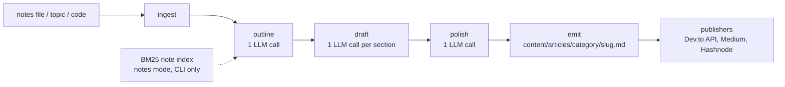

<div align="center">

# ⚒ Inkforge

AI article generator: notes, a topic or code in, Markdown articles out, cross-posted to Dev.to, Medium and Hashnode

[](https://github.com/sairam0424/Inkforge/actions/workflows/ci.yml)
[](https://github.com/sairam0424/Inkforge/actions/workflows/codeql.yml)
[](https://scorecard.dev/viewer/?uri=github.com/sairam0424/Inkforge)
[](https://github.com/sairam0424/Inkforge/releases)
[](LICENSE)


</div>

Inkforge takes a Markdown notes file, a one-line topic, or a code file or directory and turns it into a complete, human-readable article. It runs a STORM-style two-stage pipeline: the model first produces an explicit outline with per-section word budgets, then drafts each section in turn with a running summary of the preceding sections as context, and finally applies a single polish pass for voice and flow. The result is a plain `.md` file with frontmatter under `content/articles/<category>/`, optionally mirrored into a portfolio site. From there, `inkforge publish` pushes the article to Dev.to through its REST API, or to Medium and Hashnode by driving your own logged-in Chrome, always with a canonical URL pointing back at your site.

**Features**

- Three input modes: `--input` notes file, `--topic` string, or `--code` file or directory (walks up to 10 source files, skipping `node_modules`, `dist`, `.next`, `.turbo`, `.git`)
- Independent dials: tone (beginner, intermediate, senior) x format (tutorial, narrative, explainer, opinion, showcase) x length (thread 300, short 800, medium 1800, comprehensive 3500 words)
- STORM two-stage pipeline: outline is a first-class, Zod-validated artifact before any prose is drafted
- BM25 enrichment: notes-mode CLI runs index your previously generated articles under `INKFORGE_CONTENT_DIR` (plus any `INKFORGE_NOTES_DIRS`) in memory and inject the top hits into the outline prompt, no database required
- Publishers: Dev.to (API), Medium and Hashnode (browser-harness against your logged-in Chrome), Substack and LinkedIn (manual flows with tracking records)
- Canonical-URL cross-posting order so search engines treat your own site as the original
- Web UI (Next.js) with live SSE progress streaming, plus a Makefile that wraps the whole workflow
- Model fallback chains for AWS Bedrock or the Anthropic API, with a per-attempt timeout

## Table of Contents

- [Quick Start](#quick-start)
- [Install and Run Options](#install-and-run-options)
- [Configuration](#configuration)
- [Usage](#usage)
  - [CLI](#cli)
  - [Web UI](#web-ui)
  - [Makefile](#makefile)
- [Architecture](#architecture)
- [Supported Platforms](#supported-platforms)
- [Development](#development)
- [Security](#security)
- [Status and Roadmap](#status-and-roadmap)
- [Contributing](#contributing)
- [License](#license)

## Quick Start

Prerequisites: Node.js 20 or newer and pnpm 9 or newer.

```bash
git clone https://github.com/sairam0424/Inkforge.git
cd Inkforge
pnpm install
cp .env.example .env     # add Bedrock keys, or set LLM_PROVIDER=anthropic and ANTHROPIC_API_KEY
pnpm build

# Generate your first article (run from the repo root so .env is picked up)
node packages/cli/dist/index.js generate \
  --topic "How DNS resolution works" \
  --tone senior --format explainer --length medium --category system-design

# Push it to Dev.to as a draft (needs DEVTO_API_KEY in .env)
node packages/cli/dist/index.js publish --slug how-dns-resolution-works --platform devto
```

> [!IMPORTANT]
> Every generation makes several LLM calls (one for the outline, one per section, one for polish) that are billed to **your** AWS Bedrock or Anthropic account. Credentials are read only from `.env`, which is gitignored; never commit it or paste keys into the pipeline input.

The slug printed by `generate` is the one `publish` expects. `inkforge publish` creates drafts by default; add `--published` to go live.

## Install and Run Options

The packages are not published to npm yet, so there is no `npm install` or `npx` path. Pick one of:

| Option | How | Notes |
|---|---|---|
| From source (pnpm) | `pnpm install && pnpm build`, then `node packages/cli/dist/index.js <command>` | The CLI is `@inkforge/cli`; `alias inkforge="node $PWD/packages/cli/dist/index.js"` gives you the short form used below |
| Make targets | `make install build`, then `make generate TOPIC="..."` | `make help` lists every target; `.env` is loaded automatically |
| Web UI | `pnpm --filter @inkforge/web dev` (or `make dev-web`), open `http://localhost:3000` | Same pipeline and `.env`, with streaming progress in the browser (no BM25 enrichment in the web path) |

## Configuration

Copy `.env.example` to `.env`; the variables it ships are listed below, plus two optional ones the code reads that are not in the example file.

| Variable | Required when | Default / notes |
|---|---|---|
| `LLM_PROVIDER` | Optional | `bedrock`. Set `anthropic` to call the Anthropic API directly |
| `BEDROCK_ACCESS_KEY_ID` | `LLM_PROVIDER=bedrock` | AWS access key, raw or base64-encoded |
| `BEDROCK_SECRET_ACCESS_KEY` | `LLM_PROVIDER=bedrock` | AWS secret key, raw or base64-encoded |
| `BEDROCK_SESSION_TOKEN` | Optional | Temporary-credential session token, raw or base64-encoded (not in `.env.example`) |
| `BEDROCK_REGION` | Optional | `us-east-1`; falls back to `AWS_REGION` first if `BEDROCK_REGION` is unset |
| `ANTHROPIC_API_KEY` | `LLM_PROVIDER=anthropic` | Anthropic API key |
| `INKFORGE_CONTENT_DIR` | Optional | `content/articles`, resolved from the directory you run the command in |
| `INKFORGE_NOTES_DIRS` | Optional | Colon-separated extra directories to index for BM25 enrichment, in addition to `INKFORGE_CONTENT_DIR` (not in `.env.example`) |
| `INKFORGE_ANVILRY_NOTES_DIR` | Optional | Portfolio mirror directory for a second copy of each article; unset, or pointing at a directory that does not exist, disables the mirror |
| `DEVTO_API_KEY` | Publishing to Dev.to | Dev.to API key |
| `HASHNODE_API_KEY` | Legacy | Not used by the Hashnode publisher (Hashnode's public API was decommissioned in 2026-06); only the web Settings page reads it for a status indicator |
| `HASHNODE_PUBLICATION_ID` | Legacy | Same as above |
| `HASHNODE_EDITOR_URL` | Publishing to Hashnode | URL of your blog's "Write" screen, copied from your own browser |
| `BROWSER_HARNESS_BIN` | Publishing to Medium or Hashnode | `browser-harness`; path to the browser-harness binary if it is not on `PATH` |
| `INKFORGE_CANONICAL_BASE` | Publishing | Base URL for canonical links, `/<slug>` is appended; `.env.example` ships `https://sairam.dev/notes`, change it to your site |

## Usage

### CLI

```text
inkforge generate [options]   Generate an article from notes, a topic, or code
inkforge publish  [options]   Publish a generated article to external platforms
inkforge list                 List generated articles
```

**`inkforge generate`** (one of `--input`, `--topic`, `--code` is required; if several are given `--input` takes precedence, then `--topic`. The command exits before reading any input if the LLM provider is not configured.)

| Flag | Values | Default |
|---|---|---|
| `--input <file>` | Path to a Markdown notes file (notes mode) | |
| `--topic <text>` | Topic string or question (topic mode) | |
| `--code <file>` | Path to a code file or directory (code mode) | |
| `--tone <tone>` | `beginner` `intermediate` `senior` | `intermediate` |
| `--format <format>` | `tutorial` `narrative` `explainer` `opinion` `showcase` | `tutorial` |
| `--length <length>` | `thread` `short` `medium` `comprehensive` | `medium` |
| `--mode <mode>` | `oneshot` (reserved: `interactive`, `iterative` are accepted but not implemented) | `oneshot` |
| `--title <title>` | Override the article title | |
| `--tags <tags>` | Comma-separated tags | |
| `--platforms <platforms>` | Comma-separated publish targets recorded in frontmatter: `devto,hashnode` | `""` |
| `--category <category>` | `system-design` `typescript` `react` `ai-engineering` `career` `general` | `general` |
| `--date <date>` | Publication date `YYYY-MM-DD` | today |
| `--watch` | Watch the `--input` file and regenerate on every save | |

**`inkforge publish`**

| Flag | Values | Default |
|---|---|---|
| `--slug <slug>` | Article slug to publish (required) | |
| `--platform <platforms...>` | One or more of `devto` `hashnode` `medium` | |
| `--published` | Publish publicly instead of as a draft | draft |
| `--category <category>` | Category folder to look in | searches all categories |
| `--canonical-base <url>` | Canonical URL base | `INKFORGE_CANONICAL_BASE`, else `https://sairam.dev/notes` |

**`inkforge list`** takes no flags and prints title, slug, word count, reading time and platform tags from each article's frontmatter. Its default directory is `../../content/articles` relative to the current directory, so run it with `INKFORGE_CONTENT_DIR` set (the `.env` default works from the repo root); see [Status and Roadmap](#status-and-roadmap) for its current blind spot.

Examples (assuming the `inkforge` alias from above, run from the repo root):

```bash
# Notes mode: BM25 enrichment from your previously generated articles runs automatically
inkforge generate --input content/inputs/system-design/raft.md \
  --tone senior --format explainer --length comprehensive --category system-design

# Topic mode with explicit tags
inkforge generate --topic "Why idempotency keys matter" --format opinion --tags "api,reliability"

# Code mode on a directory: up to 10 .ts/.tsx/.js/.jsx/.py/.go/.rs files are read
inkforge generate --code packages/core/src/llm --format showcase --category typescript

# Watch mode: regenerate whenever the notes file is saved (Ctrl+C to stop)
inkforge generate --input content/inputs/general/draft-notes.md --watch

# Publish as a draft (default) vs. live
inkforge publish --slug why-idempotency-keys-matter --platform devto
inkforge publish --slug why-idempotency-keys-matter --platform devto --published

# Medium and Hashnode drive your own logged-in Chrome; Medium imports from the canonical URL
inkforge publish --slug why-idempotency-keys-matter --platform medium hashnode \
  --canonical-base https://your-site.dev/notes
```

### Web UI

```bash
pnpm --filter @inkforge/web dev      # http://localhost:3000
```

Pages: `/` (home), `/generate` (form with the tone, format and length dials; category is always `general` from the web UI), `/articles` and `/articles/[slug]` (browse articles; currently only sees flat `.mdx` files, see [Status and Roadmap](#status-and-roadmap)), `/settings` (shows which environment variables are configured, plus the content and mirror directory paths). API routes: `POST /api/generate` streams pipeline progress as server-sent events, `POST /api/publish` runs the publishers, `GET /api/articles` and `GET /api/articles/[slug]` read generated files, `DELETE /api/articles/[slug]` removes a file, `GET /api/config` returns configuration flags and directory paths. The UI uses a dark theme matching the Anvilry portfolio.

### Makefile

```bash
make help                                        # every target, grouped, with current defaults
make install env-setup build                     # first-time setup
make generate TOPIC="How DNS works" TONE=senior  # defaults: TONE=intermediate FORMAT=explainer LENGTH=medium CATEGORY=general
make generate-watch INPUT=content/inputs/general/notes.md
make publish-devto SLUG=how-dns-works            # draft; publish-devto-live goes public
make ci                                          # install, build, test, typecheck, security-scan
```

> [!TIP]
> The Makefile loads `.env` itself and exports every variable to the commands it runs. `make env-check` prints a Bedrock-centric checklist of common variables before your first `make generate`; it still lists the legacy `HASHNODE_API_KEY` and does not check `ANTHROPIC_API_KEY` or `HASHNODE_EDITOR_URL`, so treat it as a hint rather than the full picture.

## Architecture



`@inkforge/core` holds the pipeline, RAG layer, LLM abstraction, Zod schemas and publishers. `@inkforge/cli` is a Commander shell over core. `@inkforge/web` is a Next.js app that calls the same `generate()` with an `onProgress` callback and streams the events to the browser.

**LLM fallback chains** (`packages/core/src/llm/index.ts`, 120 s timeout per attempt; falls through to the next model on connection errors, HTTP 429/404/5xx, model-unavailable 400s and per-model not-authorized 403s, but not on bad credentials):

- Bedrock (default): `us.anthropic.claude-sonnet-4-6` -> `us.anthropic.claude-haiku-4-5-20251001-v1:0` (Opus is deliberately excluded until it is enabled in the AWS account)
- Anthropic (`LLM_PROVIDER=anthropic`): `claude-sonnet-4-6` -> `claude-opus-4-7` -> `claude-haiku-4-5`

Depth lives in [docs/architecture.md](docs/architecture.md) (pipeline stages, chunker and BM25 parameters, streaming, path resolution) and [docs/publishing.md](docs/publishing.md) (per-platform rules and the cross-posting order).

**Content layout**

```text
content/
  articles/<category>/<slug>.md        generated output        gitignored
  inputs/<category>/<slug>.md          raw input, saved per run gitignored
  published/
    devto|medium|hashnode|substack/<slug>.md   tracking records   committed
    linkedin/<slug>/post.md                    caption and notes  committed
    linkedin/<slug>/slides/, *.pdf             carousel binaries  gitignored
    assets/<slug>/                             shared media       committed
```

Generated articles are output, not source, so they are never committed; the tracking records in `content/published/` are the source of truth for what is live where (format in [content/published/README.md](content/published/README.md)).

## Supported Platforms

| Platform | How | Needs |
|---|---|---|
| Your own site (Anvilry) | Mirrored on every `generate` when `INKFORGE_ANVILRY_NOTES_DIR` is set and the directory exists | `INKFORGE_ANVILRY_NOTES_DIR` |
| Dev.to | `inkforge publish --platform devto`, REST API, draft unless `--published`, max 4 tags, `canonical_url` set | `DEVTO_API_KEY` |
| Medium | `inkforge publish --platform medium`, browser-harness imports the canonical URL via `medium.com/p/import` | `browser-harness`, a logged-in Chrome, a correct canonical base (the CLI always sends `--canonical-base`, defaulting to `INKFORGE_CANONICAL_BASE` and then `https://sairam.dev/notes`, so set yours) |
| Hashnode | `inkforge publish --platform hashnode`, browser-harness fills your blog's editor (public API decommissioned 2026-06) | `browser-harness`, a logged-in Chrome, `HASHNODE_EDITOR_URL` |
| Substack | Manual paste with an attribution line; the code stub throws a clear error | Nothing |
| LinkedIn | Manual carousel PDF or text post from `content/published/linkedin/<slug>/` | Nothing |

Cross-posting order for SEO: your own site first (sets the canonical source), then Medium, Dev.to, Hashnode, and finally Substack or LinkedIn. The browser-harness publishers never see your password; if Chrome is not logged in they stop and ask you to log in yourself. Medium's import path enforces its editor rules (no H3, no tables) through `medium-content-validator.ts`.

## Development

```bash
pnpm build        # turbo: core -> cli -> web
pnpm test         # vitest, currently all tests live in packages/core/src/**/__tests__/
pnpm typecheck    # all packages
pnpm lint
make ci           # install + build + test + typecheck + security-scan, mirrors the GitHub Actions job
```

Branches flow `feature/*` -> `develop` -> `main`; releases are promoted from `develop` to `main` by PR and recorded in [CHANGELOG.md](CHANGELOG.md) (Keep a Changelog). Commits follow Conventional Commits. New pipeline stages need unit tests with mocked LLM responses; see [CONTRIBUTING.md](CONTRIBUTING.md) for the full checklist, including how to add a publisher or a generation format.

## Security

- CI "Security Audit" job: `pnpm audit --audit-level high` plus a grep for hard-coded AWS keys on every push to `main`, `develop` and feature branches and on every PR ([ci.yml](.github/workflows/ci.yml))
- [CodeQL](.github/workflows/codeql.yml) on pushes to `develop`, pull requests and a weekly schedule; [OpenSSF Scorecard](.github/workflows/scorecard.yml) with published results (the badge above is the repo's own run); [Gitleaks](.github/workflows/gitleaks.yml) secret scanning; Dependabot for npm and GitHub Actions; SHA-pinned actions with least-privilege permissions
- Credentials come only from environment variables; `.env` is gitignored, the web `/api/config` route returns configured/not-configured booleans and the content and mirror directory paths but never key values, and the browser-harness publishers refuse to handle logins or MFA
- The dependency audit gate can turn red when new advisories land in a transitive dependency; the current state is tracked under "Security" in [CHANGELOG.md](CHANGELOG.md)
- Report vulnerabilities privately as described in [SECURITY.md](SECURITY.md)

## Status and Roadmap

Honest state of the project today:

- `@inkforge/core` and `@inkforge/cli` are not on npm; run from source or via `make`
- `--mode interactive` and `--mode iterative` are accepted by the CLI and schema but not implemented in core; every run is `oneshot`
- Medium and Hashnode publishing depend on `browser-harness` and an already logged-in Chrome; Hashnode's editor selectors were not live-verified, and the canonical URL in Hashnode's SEO settings and Medium's Story Settings still needs a manual check (the tracking record reminds you)
- `inkforge list` and the web `/articles` page read flat `.mdx` files, so neither sees the `content/articles/<category>/<slug>.md` layout that `generate` writes; use `make content-tree` or `make publish-status` meanwhile
- The web UI always generates into the `general` category and skips BM25 enrichment
- Tests cover `@inkforge/core` only; `@inkforge/cli` and `@inkforge/web` have none yet
- Substack has no publish API, and LinkedIn is a manual flow by design

## Contributing

Issues and pull requests are welcome. Read [CONTRIBUTING.md](CONTRIBUTING.md) for setup, the `develop`-based branching model, commit convention and PR process, and [CODE_OF_CONDUCT.md](CODE_OF_CONDUCT.md) for community standards. Bug reports and feature requests have [issue templates](.github/ISSUE_TEMPLATE); security reports go through [SECURITY.md](SECURITY.md), not public issues.

## License

[MIT](LICENSE)
